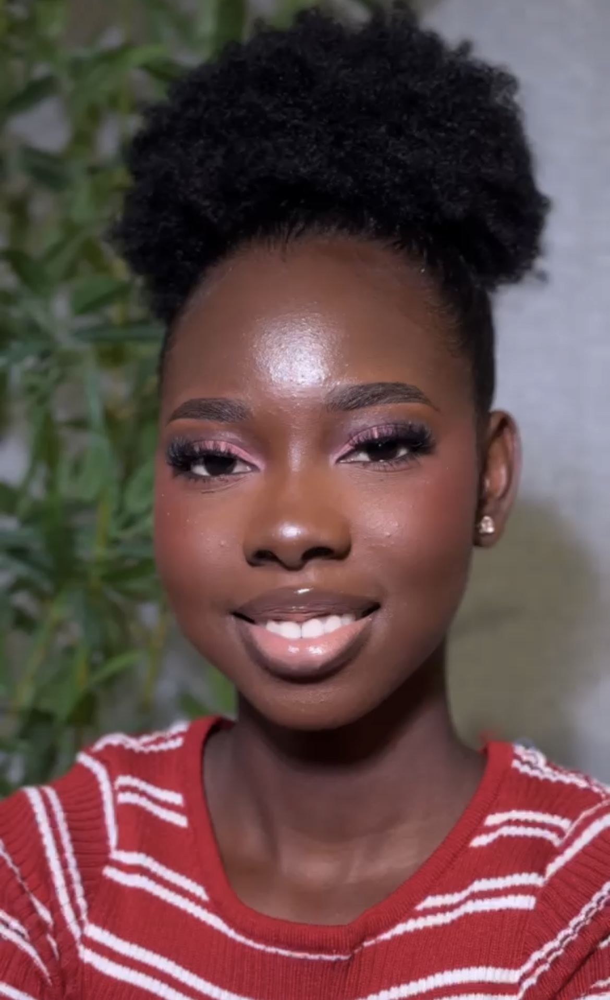

<!DOCTYPE html>
<html lang="en">
<head>
    <meta charset="utf-8">
    <meta name="viewport" content="width=device-width, initial-scale=1.0">
    <title>Glamby_Tenora | Luxury Makeup Studio</title>
    <link href="https://googleapis.com" rel="stylesheet">
    
</head>
<body>
    

    <nav>
        
✦

        <h1>GLAMBY_TENORA</h1>
        
✦

    </nav>
    <header>
        <h2>DEFINE YOUR GLAMOUR. own it.</h2>
        
Luxury specialized makeup artistry crafted elegantly to amplify your natural beauty. Flawless bridal sets, striking editorial formats, and signature soft glam updates.

        <a href="tel:+2348135264810" class="btn-luxe">✨ Book Studio Appointment</a>
    </header>
    <section>
        
The Menu

        

            

                <h4>Signature Soft Glam</h4>
                
Luminous skin finish, organic shadow definition, and custom lash layout.

            

            
₦15,000

        

        

            

                <h4>Full Editorial Luxury</h4>
                
High-definition mapping, creative color sets, and luxury contour execution.

            

            
₦25,000

        

    </section>
    <section style="max-width: 100%; background: rgba(15, 10, 13, 0.4); padding: 50px 0;">
        

            
The Lookbook

        

        
        <!-- 📸 Perfect Dynamic Row Grid mapped straight to your exact uploaded photos -->
        

            

            

            

            

            

            

            

        

    </section>
    <footer>
        
© 2026 GLAMBY_TENORA STUDIO. KOSOFE, LAGOS. ALL RIGHTS RESERVED.

    </footer>
    
</body>
</html>
